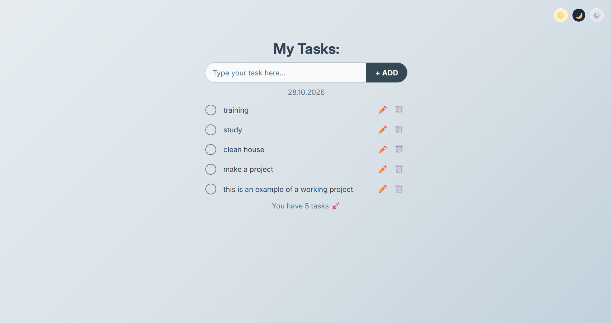

# ToDo List
A pet project built to practice React, with drag-and-drop and theme switching.



## Tech stack

+ React
+ TypeScript
+ dnd-kit
+ LocalStorage
+ Vite
+ CSS
+ Jest and React Testing Library
+ Playwright

## Functionality

+ Add, edit and delete tasks
+ Tasks are saved in the browser (LocalStorage)
+ Reorder tasks with drag and drop
+ Light, dark and system themes

## Getting Started

```bash
npm install
npm run dev
```

## Testing

Unit tests cover the custom hooks `useTasks` and `useLocalStorage`:

```bash
npm test
```

End-to-end tests (Playwright) cover the main user flows: adding a task and keeping it after a page reload, completing, editing, deleting a task, and switching the theme:

```bash
npx playwright install chromium   # first run only
npx playwright test
```

## Plans

+ [x] Tests (unit and e2e)
+ [ ] Filters by task status